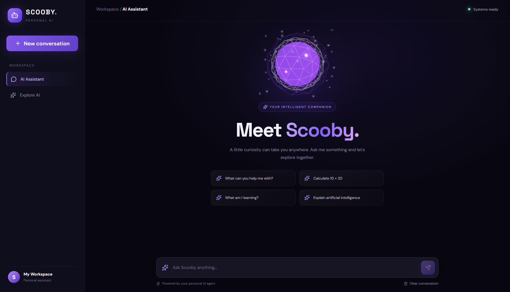
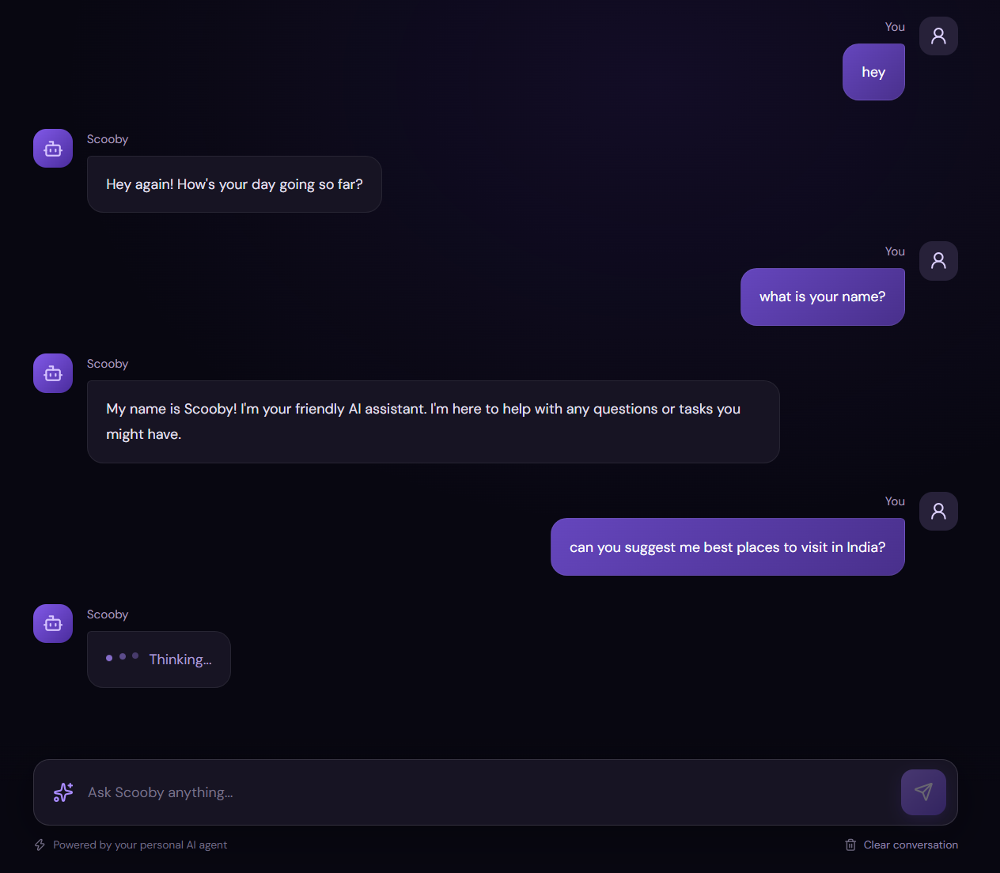
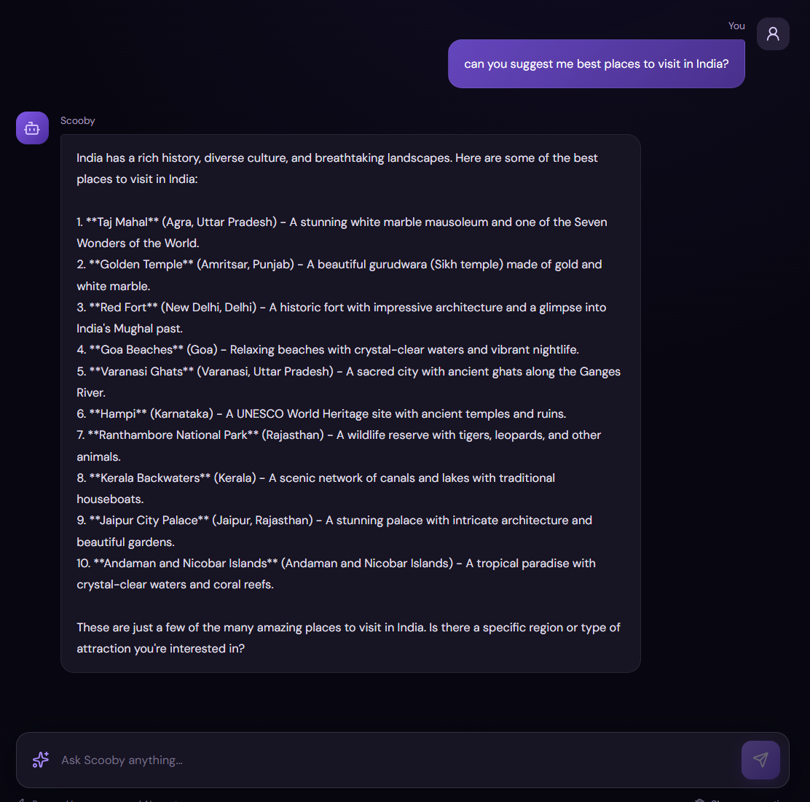

# Scooby – AI Personal Assistant

Scooby is an AI-powered personal assistant built with **Python, FastAPI, LangChain, and React**. It combines conversational AI, intelligent agents, and Retrieval-Augmented Generation (RAG) to provide an interactive assistant experience.
##LIVE LINK https://ai-agent-project-eta.vercel.app/

## Features
- Conversational AI with an interactive chat interface
- AI agent powered by LangChain and LangGraph
- RAG-based knowledge retrieval
- Local LLM integration using Ollama
- Vector search with ChromaDB
- FastAPI backend with REST API support
- Modern React and TypeScript frontend






 

## Tech Stack
**Frontend:** React, TypeScript, Vite, CSS, Three.js

**Backend:** Python, FastAPI, LangChain, LangGraph

**AI & Data:** Ollama, ChromaDB, RAG


## Run Locally

**Backend**
```bash
cd backend
uvicorn main:app --reload
```

**Frontend**
```bash
cd frontend
npm install
npm run dev
```

## Author

**Sahithi Gayye**  
AI Engineer | Full Stack Developer

[GitHub](https://github.com/sgayye-6612)
